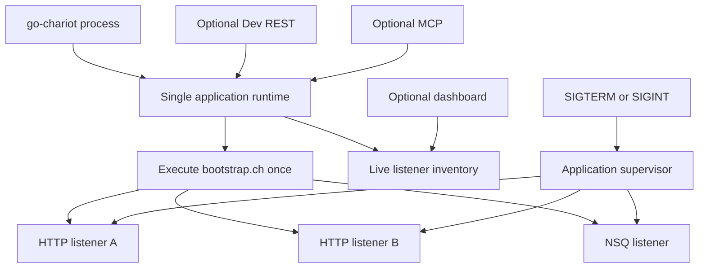

## Chariot Listener Assessment

Chariot has a viable foundation for deploying custom application services. The intended production model is **bootstrap-driven**: a pre-coded `bootstrap.ch` initializes application state and launches one or more HTTP or NSQ listeners. This is distinct from the DevTest environment and its persistent Listener Registry.

Three related but separate concepts currently use the term “listener”:

1. The Chariot `listen()` HTTP service primitive.
2. The Chariot `listenNSQ()` event-consumer primitive.
3. The persistent Listener Registry managed through Charioteer and REST.

The first two create real network resources and are sufficient to form the core of a headless Chariot application. The third is currently a DevTest management facility whose Start, Exit, status, and health behavior does not reliably control or reflect those resources.

### Intended production model



A production application should run with configuration equivalent to:

- `CHARIOT_HEADLESS=true`
- `CHARIOT_DEV_REST_ENABLED=false`
- `CHARIOT_BOOTSTRAP=bootstrap.ch`

At startup, `bootstrap.ch` may load trees and function libraries, establish globals, and call any number of `listen()` and `listenNSQ()` functions. When Dev REST is disabled, go-chariot keeps the headless process alive after bootstrap completes.

This architecture is sound in principle: **`bootstrap.ch` is the application composition root**, and listeners are resources owned by its runtime.

### Revised overall rating

| Area | Completeness | Usability |
|---|---:|---:|
| Bootstrap-driven headless hosting | Moderate–high | Moderate |
| HTTP `listen()` runtime | Moderate | Low until documented correctly |
| NSQ `listenNSQ()` runtime | Moderate | Low–moderate |
| Application lifecycle and shutdown | Low | Poor |
| DevTest Listener Registry | Low | Misleading in its current form |
| Documentation and examples | Low | Incorrect or incomplete |
| Test coverage | Low | Insufficient for lifecycle guarantees |

---

## What works well

### Bootstrap can compose multiple services

Headless startup creates a runtime, registers standard functions, loads the configured function library, and executes the configured bootstrap script. A bootstrap can therefore prepare shared application state and launch multiple listeners that retain access to that runtime.

When Dev REST is disabled and headless mode is enabled, the process remains alive after bootstrap execution. This supports the intended custom-service deployment model without exposing the DevTest REST surface.

### HTTP requests are represented usefully

The HTTP listener builds a structured request object containing:

- method and path
- query parameters and raw query string
- headers
- raw body
- decoded JSON body
- form data
- host, remote address, scheme, and timestamp

This is a useful foundation for webhooks, decision services, and custom Chariot APIs. Handlers may be supplied as either named functions or function values.

### HTTP listener options are useful

The implementation supports:

- allowed methods
- base path
- read timeout
- write timeout
- idle timeout
- startup program
- exit program

### Basic collision protection exists

HTTP ports are tracked globally and duplicate registrations through the Chariot runtime are rejected. NSQ listeners similarly reject duplicate topic/channel registrations within a runtime.

### NSQ routing is realistic

`listenNSQ()` supports:

- routing by `messageType`
- named or inline handlers
- concurrent NSQ consumers
- maximum in-flight configuration
- direct NSQD or lookupd discovery
- response-topic registration
- per-handler fallback response keys
- startup and exit hooks

There is also an environment-dependent end-to-end NSQ test.

---

# Production-critical findings

## 1. The documented `listen()` signature is incorrect

The System Functions documentation currently describes:

```chariot
listen(port [, onstart, onexit])
```

and gives examples equivalent to:

```chariot
listen(8080)
listen(8081, "onStartProgram", "onExitProgram")
```

The implemented contract is:

```chariot
listen(port, handler [, options])
```

Consequences of the current documentation:

- `listen(8080)` fails because a handler is mandatory.
- In `listen(8081, "onStartProgram", "onExitProgram")`, `onStartProgram` is interpreted as the request handler.
- A string third argument is interpreted only as the exit program; it is not an `onStart` argument.

A correct example is:

```chariot
listen(8080, "onDecisionRequest")

listen(
    8080,
    "onDecisionRequest",
    map(
        "on_start", "listenerStarted",
        "on_exit", "listenerStopped",
        "methods", array("POST"),
        "base_path", "/decision",
        "read_timeout_ms", 15000,
        "write_timeout_ms", 30000
    )
)
```

This is the most immediate usability defect because users cannot discover the real API without reading Go source.

## 2. HTTP startup can falsely report success

`listen()` registers its runtime listener, starts `ListenAndServe()` in a goroutine, and immediately returns a result reporting `listening`.

The operating-system bind happens asynchronously. If another process owns the port, bootstrap can appear to complete successfully and the bind failure is only logged later.

For production application deployment, listener startup must be fail-fast. The implementation should:

1. Call `net.Listen()` synchronously.
2. Return any bind error directly from `listen()`.
3. Register the successfully bound resource.
4. Run `http.Server.Serve(listener)` asynchronously.

This also allows a failed bootstrap to stop already-created resources and exit nonzero.

## 3. Bootstrap failure is nonfatal in headless mode

Bootstrap read, path-resolution, and execution failures are currently logged as warnings. The process can then remain alive indefinitely without exposing its intended services, or with only a subset of them running.

The production policy should be:

```text
bootstrap failure
  → log an error
  → stop resources already started by that runtime
  → exit with a nonzero status
```

A lenient policy may remain useful in DevTest mode, but headless service deployment should fail closed.

## 4. Bootstrap may execute twice when Headless and Dev REST are both enabled

Headless startup creates one bootstrap runtime and executes `bootstrap.ch`. If Dev REST is also enabled, REST handler initialization creates another bootstrap runtime and executes the same bootstrap again.

For a bootstrap containing `listen()` calls, the second execution attempts to create duplicate services and bind the same ports. It also produces two independent runtime states.

This affects the intended debug profile where the custom application and Dev REST surface run together.

The process should create one application runtime, execute bootstrap exactly once, and inject that runtime into:

- Dev REST handlers
- session inheritance
- MCP
- dashboard and diagnostics
- listener supervision

## 5. There is no graceful application shutdown

Headless operation without Dev REST currently waits forever. There is no signal-driven shutdown path that:

- stops HTTP listeners
- stops NSQ consumers
- waits for in-flight requests or messages
- invokes listener exit hooks
- invokes an application-level exit hook
- reports shutdown errors

Docker and Kubernetes eventually terminate the process, but listener `on_exit` hooks are not guaranteed to run.

The application host should catch `SIGINT` and `SIGTERM`, cancel the application context, and shut down every resource owned by the bootstrap runtime within a configurable deadline.

## 6. Listener resources have no unified ownership API

`listen()` and `listenNSQ()` register internal resources against a runtime, but no public runtime-level operation stops all resources for that runtime. `UnregisterRuntime()` also does not shut down listeners.

The runtime needs a listener supervisor or resource owner with operations equivalent to:

- start/register
- list/status
- stop one resource
- stop all resources
- await shutdown

This does not require the persistent DevTest registry to become the production supervisor. The live inventory can be runtime-owned and separate from persisted application definitions.

## 7. Production observability is limited

A bootstrap can launch several listeners, but there is no unified live view containing:

- listener type
- bound address and port, or NSQ topic/channel
- startup time and current state
- last request/message time
- last successful handler time
- last error
- request/message count
- failure count
- in-flight count

These facts should come from live resources, not from persisted registry status.

---

# DevTest Listener Registry assessment

The persistent Listener Registry should be treated as a separate DevTest concept rather than the production application host. Its intended semantics need to be made explicit.

## Option A: Real DevTest supervisor

Under this model, Charioteer provides a temporary host for testing application-service scripts. Then registry operations should be real:

- **Start** executes the selected `script_file` in an owned runtime.
- It captures all listeners created by that execution.
- It reports success only after resources are operational.
- **Exit** stops those resources and runs shutdown hooks.
- status and health are derived from live resources.
- editing and deletion require the test instance to be stopped.

This option best matches the current Charioteer controls and user expectations.

## Option B: Application-definition catalog

Under this model, the registry only stores and prepares deployment definitions. It should not present operational state.

The current **Start**, **Exit**, `running`, and `healthy` UI should be replaced by actions such as:

- **Validate**
- **Run in test session**
- **Add to bootstrap**
- **Publish application**

Persisted runtime fields should be removed because they cannot prove that a live resource exists.

## Current registry behavior is between the two models

At present:

- Charioteer requires and displays a primary `script_file`.
- `Manager.Start()` does not execute that primary file.
- `Manager.Start()` runs only the optional `OnStart` program and then marks the entry running and healthy.
- `Manager.Stop()` runs `OnExit` and changes metadata but does not call HTTP shutdown or stop an NSQ consumer.
- `LastActive` is initialized on Start but is not updated from HTTP requests or NSQ messages.
- persisted `running` state may survive a process restart even though no resource survives.

Therefore the current registry status represents administrative intent, not live service state. Until Option A or Option B is selected, its `running` and `healthy` fields should not be treated as operational evidence.

## Registry auto-start should not be part of the production path by default

Production services are already composed explicitly in `bootstrap.ch`. Automatically starting persisted DevTest definitions in headless mode introduces a second application-start mechanism and creates ambiguous ownership.

Recommended direction:

- Production: bootstrap is the sole application startup path.
- DevTest: registry definitions may run in isolated test runtimes.
- Publishing: Charioteer may generate or update bootstrap content from validated definitions.

---

# HTTP usability and safety gaps

## Request execution is serialized per listener

Each HTTP listener uses one mutex around Chariot handler execution. One slow request therefore blocks all other handlers for that listener.

This may be a valid actor-style safety model for a mutable runtime, but it must be documented. Longer term, support one of:

- explicitly configurable single-threaded execution
- runtime-per-request
- a runtime pool
- isolated handler runtimes with controlled shared state

## Request bodies are unbounded

The HTTP listener reads the complete body with `io.ReadAll()` and applies no size limit. A public endpoint can therefore consume excessive memory.

Add a `max_body_bytes` option and enforce it with `http.MaxBytesReader()`.

## Invalid JSON still reaches the handler

Malformed JSON is represented through `body_error`, after which the handler is still called. This can be a useful tolerant mode, but it is surprising as a default.

Either reject malformed JSON with `400`, or add and document a `strict_json` option.

## Base-path matching is too broad

A base path of `/api` currently accepts `/apix` because matching uses a simple string prefix. Matching should require either exact `/api` or prefix `/api/`.

## Response control is limited

Handler values are serialized as JSON, but handlers cannot directly control status, headers, content type, cookies, or redirects.

A structured response contract would improve API usability:

```chariot
map(
    "status", 201,
    "headers", map("location", "/orders/123"),
    "body", map("id", 123)
)
```

## Bind address and transport security are implicit

HTTP listeners bind to all interfaces using `:<port>`. There is no listener-level bind-address, TLS, authentication, or middleware configuration.

Reverse-proxy deployment can provide TLS and authentication, but bind address and request limits should still be explicit production options.

## Option validation is weak

Unknown option names and several invalid option values are silently ignored. Typos can therefore fall back to unsafe or unexpected defaults.

Configuration should fail on:

- unknown keys
- wrong value types
- negative timeouts
- invalid method names
- invalid limits

---

# NSQ-specific gaps

## Configured concurrency does not create parallel Chariot execution

NSQ registers concurrent handlers, but Chariot handler execution is protected by a listener-wide mutex. The `concurrency` option increases NSQ delivery concurrency without increasing Chariot execution concurrency.

The option should be documented as delivery concurrency, or runtime isolation/pooling should be added.

## Several failures acknowledge and drop messages

The NSQ handler returns success for several invalid or unrouteable cases, including malformed JSON, missing `messageType`, missing handlers, and unresolved response topics.

Some poison messages should be acknowledged, but the policy must be explicit. Useful controls include:

- `requeue_on_decode_error`
- `requeue_on_missing_handler`
- maximum attempts
- backoff
- dead-letter topic
- optional versus required responses

## Configured defaults are not fully usable from `listenNSQ()`

Startup logic can apply configured default topic and channel values, but argument parsing rejects empty topic and channel arguments before those fallbacks are reached.

Either remove the unreachable fallback or allow empty/`DBNull` arguments to select configured defaults.

## NSQ tests depend on an external daemon

The end-to-end test skips when NSQD is unavailable. Unit coverage is still needed for:

- routing normalization
- malformed payloads
- retry decisions
- response-topic failures
- duplicate registration
- startup and exit hooks
- shutdown
- concurrency semantics

---

# Documentation requirements

The listener documentation should distinguish two workflows:

1. **Headless application deployment** — `bootstrap.ch` composes and starts services.
2. **DevTest listener management** — Charioteer validates or temporarily hosts listener definitions.

The System Functions reference must document:

- the mandatory HTTP handler
- named and inline handlers
- request object schema
- response serialization and structured response behavior
- options map and validation
- method and base-path matching
- timeout and body-size controls
- startup and exit semantics
- concurrency semantics
- listener status and shutdown operations
- `listenNSQ()`
- `registerResponseTopic()`
- `listResponseTopics()`

Duplicate System Functions documents should have one canonical source to prevent drift.

Container documentation should use current canonical environment variables and show `CHARIOT_BOOTSTRAP=bootstrap.ch` as the application entrypoint. References to unsupported startup-file variables or unused `CHARIOT_ON_START` behavior should be removed or implemented.

---

# Recommended implementation priority

## P0 — Reliable bootstrap-driven applications

1. Correct the documented `listen()` signature and examples.
2. Construct one application runtime and execute bootstrap exactly once.
3. Make bootstrap failures fatal in headless production mode.
4. Bind HTTP sockets synchronously and propagate startup errors.
5. Add a runtime-owned listener supervisor for HTTP and NSQ resources.
6. Add signal-driven graceful shutdown with a deadline.
7. Stop all resources if bootstrap starts only part of the application and then fails.
8. Remove production dependence on registry auto-start, or explicitly gate it as a DevTest feature.

## P1 — Define the DevTest registry

1. Choose real supervisor or definition catalog semantics.
2. If it is a supervisor, make Start/Exit control real resources in an isolated runtime.
3. If it is a catalog, remove synthetic operational status and rename UI actions.
4. Add live status, activity, errors, and counts to runtime-owned diagnostics.
5. Add HTTP listener tests covering bind failure, requests, options, errors, and shutdown.
6. Add tests proving bootstrap executes once in production and debug profiles.

## P2 — Production hardening

1. Request-body limits.
2. Configurable bind address.
3. Structured HTTP responses.
4. Exact base-path routing.
5. Explicit runtime concurrency policy.
6. Authentication or middleware integration points.
7. NSQ retry and dead-letter policies.
8. Listener metrics and health endpoints.

---

## Bottom line

The intended bootstrap-driven headless architecture is viable and more complete than a registry-centered interpretation suggests. Chariot can already execute `bootstrap.ch`, launch multiple HTTP and NSQ services from one runtime, and remain alive without exposing the DevTest server.

The principal production gaps are fail-fast startup, fatal bootstrap errors, single-runtime ownership, graceful shutdown, and accurate documentation. Addressing those areas would make bootstrap-hosted Chariot applications substantially safer and easier to deploy.

The persistent Listener Registry should remain conceptually separate. It must either become a real DevTest supervisor or be simplified into a definition and publishing catalog; its current synthetic Start, Exit, health, and status behavior should not be confused with the live listener resources owned by a deployed bootstrap runtime.

See [Chariot Listener Refactor Plan](Chariot%20Listener%20Refactor%20Plan.md) for the dependency-ordered implementation work packages, acceptance gates, tests, and migration guidance.
