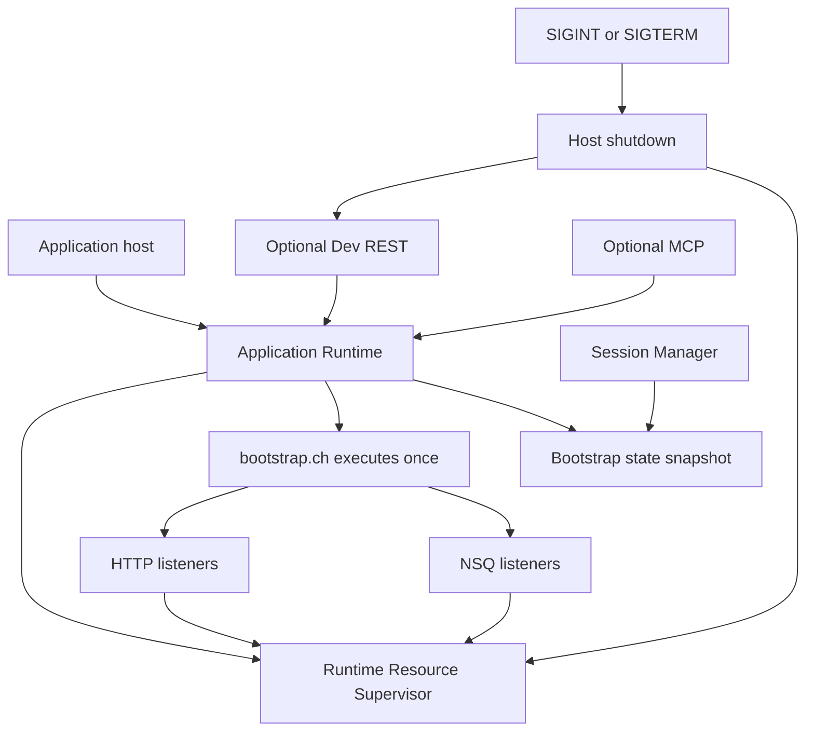

# Chariot Listener Refactor Plan

## Current delivery status (final verification)

- WP7 DevTest supervisor and lifecycle hardening are present in the working tree;
    parent validation passed for all affected unit/integration packages, affected
    race tests, and `go vet`. The precise completed gates and remaining caveats
    are recorded in the [final validation record](#final-validation-record).
- WP8 canonical references and runnable examples are authored. Root System
    Functions, Listener Functions and container guidance are canonical; matching
    service-local references link to them. The service README links the supported
    workflow in [examples/listeners](../../examples/listeners/README.md).
- v2 persistence is configuration-only; v1 live status and legacy `auto_start`
    are ignored. **All registry auto-start is currently disabled**. The stored v2
    `auto_start_devtest` preference is inert, not an implemented startup policy.
- Start requires `script_file` and at least one live listener; `script` is a
    display label. Clones provide ownership isolation, not a security sandbox.
    Hook strings are programs (or registered library function names), not implicit
    invocations of bare `setq` function variables.
- Charioteer all tests, the Visual DSL production build, example validator,
    connected `TestListenNSQEndToEnd`, and the host API create/start/request/shutdown
    test passed in parent validation. Manual SIGINT/SIGTERM smoke and container
    build/push were not performed. Publishing-helper defects and arbitrary
    blocked-host-code limitations remain unresolved.

Earlier dated milestone validation entries below are historical reports, not
fresh validation of the current combined working tree.

## Objective

Make bootstrap-driven Chariot applications reliable enough for production while preserving Charioteer as a DevTest environment.

The target production lifecycle is:

1. Create one application runtime.
2. Register built-ins and load the function library.
3. Execute `bootstrap.ch` exactly once.
4. Require every listener declared by bootstrap to start successfully.
5. Keep the application runtime alive.
6. Optionally expose Dev REST and MCP against that same runtime.
7. On shutdown, stop every resource owned by the runtime and invoke exit hooks.

The target DevTest lifecycle is:

1. Persist listener application definitions separately from live state.
2. Start a selected definition in an isolated, owned test runtime.
3. Derive status and health from live resources.
4. Stop and dispose that runtime deterministically.
5. Allow validated definitions to be incorporated into a production bootstrap.

---

## Guiding decisions

### 1. Bootstrap is the production composition root

`bootstrap.ch` remains the canonical way to launch one or more custom application services. Production startup must not depend on persisted Charioteer Listener Registry state.

### 2. Runtime owns live resources

HTTP servers and NSQ consumers started by a Chariot runtime are resources owned by that runtime. They must not be managed only through package-global maps with no runtime lifecycle API.

### 3. Persisted definitions are not live status

The DevTest Listener Registry may persist names, scripts, hooks, and auto-test preferences. It must not persist `running`, `healthy`, or other transient facts as authoritative state.

### 4. Fail fast and clean up transactionally

If bootstrap starts listener A and listener B fails, startup must stop A before returning failure. A partially started application must not remain alive.

### 5. Preserve session isolation

Application listeners belong to the application runtime. User/session runtimes may inherit bootstrap data and functions, but must not inherit ownership of application listener resources.

### 6. Prefer one canonical API over compatibility shims

Correct the documented `listen()` contract and update callers. Do not add adapters that preserve the incorrect documented signature.

---

## Target architecture



### Runtime resource supervisor

Introduce a runtime-owned lifecycle abstraction in the `chariot` package. The implementation may initially wrap the existing HTTP and NSQ registries, but external callers should use one API.

Suggested public surface:

```go
type ListenerKind string

const (
    ListenerHTTP ListenerKind = "http"
    ListenerNSQ  ListenerKind = "nsq"
)

type ListenerStatus struct {
    ID                 string
    Kind               ListenerKind
    State              string
    Address            string
    Port               int
    Topic              string
    Channel            string
    StartedAt          time.Time
    LastActiveAt       time.Time
    LastSuccessAt      time.Time
    LastError          string
    RequestCount       uint64
    FailureCount       uint64
    InFlightCount      int64
}

func (rt *Runtime) ListListeners() []ListenerStatus
func (rt *Runtime) StopListener(ctx context.Context, id string) error
func (rt *Runtime) ShutdownListeners(ctx context.Context) error
```

The concrete HTTP server and NSQ consumer types should remain private.

Listener IDs should be stable for the process lifetime and unambiguous:

- HTTP: `http:<bind-address>:<port>`
- NSQ: `nsq:<topic>:<channel>`

---

# Work packages

## WP0 — Lock contracts with characterization tests

### Purpose

Protect current working behavior before changing ownership and startup flow.

### Work

Add tests that establish:

- `listen(port, handler)` accepts a named handler.
- `listen(port, function)` accepts an inline function.
- request maps contain the currently supported HTTP fields.
- ordinary return values are serialized as JSON.
- `DBNull` produces `204 No Content`.
- duplicate listener registration is rejected.
- `listenNSQ()` routes a known `messageType` to the expected handler.
- response-topic registration remains compatible.

Use loopback listeners and dynamically allocated ports. Do not require external services for HTTP tests.

### Primary files

- `services/go-chariot/chariot/http_listener.go`
- `services/go-chariot/chariot/system_funcs.go`
- new focused tests under `services/go-chariot/chariot/` or `services/go-chariot/tests/`
- `services/go-chariot/tests/nsq_listener_test.go`

### Exit gate

- Existing tests pass.
- New HTTP characterization tests are deterministic and require no Docker services.
- No production behavior has changed yet.

---

## WP1 — Add runtime-owned listener inventory and shutdown

### Purpose

Create the lifecycle foundation before changing process startup or Charioteer.

### Work

1. Define exported, immutable `ListenerStatus` snapshots.
2. Add runtime-level list, stop-one, and stop-all operations.
3. Adapt existing HTTP and NSQ registration paths to expose lifecycle through the runtime API.
4. Ensure shutdown copies listener references while holding registry locks, then releases locks before waiting or invoking hooks.
5. Make shutdown idempotent.
6. Ensure listener exit hooks run at most once.
7. Aggregate multiple shutdown errors with listener identity.
8. Update activity and counters at request/message boundaries.
9. Ensure `UnregisterRuntime()` either shuts down owned resources or explicitly refuses removal while resources remain. Prefer a context-aware unregister/close operation over hidden background cleanup.

### Concurrency requirements

- Do not hold global registry locks while calling `http.Server.Shutdown()`.
- Do not hold registry locks while waiting on NSQ `StopChan`.
- A listener stopping concurrently with runtime shutdown must not panic or execute its exit hook twice.
- Inventory snapshots must be race-safe.

### Primary files

- `services/go-chariot/chariot/runtime.go`
- `services/go-chariot/chariot/http_listener.go`
- `services/go-chariot/chariot/nsq_listener.go`

### Tests

- inventory contains active HTTP listener details.
- inventory contains active NSQ listener details without requiring a live NSQ daemon where practical.
- stop-one closes only the selected listener.
- stop-all closes every owned HTTP listener.
- shutdown is idempotent.
- exit hook executes exactly once.
- cancellation/deadline is respected.
- race test for concurrent inventory and shutdown.

### Exit gate

A runtime can enumerate and deterministically stop every listener it owns.

---

## WP2 — Make HTTP startup synchronous and fail-fast

### Purpose

Prevent bootstrap from reporting success before the operating system accepts a listener.

### Work

1. Add bind-address support to HTTP listener options, defaulting to the current all-interface behavior for compatibility.
2. Replace asynchronous `ListenAndServe()` binding with:
   - synchronous `net.Listen("tcp", address)`
   - registration after successful bind
   - asynchronous `http.Server.Serve(net.Listener)`
3. If registration fails after binding, close the socket immediately.
4. Return the actual bound address in listener status.
5. Consider allowing port `0` for DevTest only so tests and temporary listeners can request an ephemeral port. Keep production examples explicit.
6. Make `on_start` semantics precise:
   - bind succeeds first
   - register live resource
   - run `on_start`
   - if `on_start` fails, shut down and return failure
7. Record asynchronous serve errors in live status and mark the listener failed.

### Compatibility note

The current implementation logs `on_start` failure and continues. Changing this to fail startup is an intentional correctness change and should be included in release notes.

### Primary files

- `services/go-chariot/chariot/http_listener.go`
- `services/go-chariot/chariot/system_funcs.go`

### Tests

- an occupied port causes `listen()` to return an error synchronously.
- successful return guarantees that the socket accepts connections.
- failed registration closes the pre-bound socket.
- failed `on_start` closes the listener.
- unexpected `Serve()` failure updates status.
- configured bind address is honored.

### Exit gate

A successful `listen()` result guarantees a bound, registered HTTP resource.

---

## WP3 — Centralize application runtime and bootstrap loading

### Purpose

Execute bootstrap exactly once and share the resulting application state with optional service surfaces.

### Work

Extract application initialization from both `main()` and `NewHandlers()` into a single constructor, for example:

```go
type ApplicationRuntime struct {
    Runtime *chariot.Runtime
}

func BuildApplicationRuntime(ctx context.Context, options ApplicationRuntimeOptions) (*ApplicationRuntime, error)
```

The constructor should:

1. Create one runtime.
2. register all Chariot functions.
3. load and register the function library.
4. resolve and read the canonical bootstrap path.
5. execute bootstrap exactly once.
6. shut down listeners if any initialization step fails.
7. return an error rather than log-and-continue.

Refactor dependency construction so:

- `main()` creates the application runtime.
- REST handlers receive the existing runtime rather than creating one.
- `SessionManager.SetBootstrapRuntime()` receives the same initialized runtime for state inheritance.
- network MCP receives a runtime provider for the same application runtime.
- standalone MCP modes explicitly construct one application runtime when bootstrap-aware behavior is required.
- session runtimes copy data/functions but do not rerun listener-producing bootstrap code.

### API changes

Replace implicit construction:

```go
handlers.NewHandlers(sessionManager)
```

with explicit injection, such as:

```go
handlers.NewHandlers(sessionManager, applicationRuntime)
```

If tests require a convenience constructor, keep it test-only or name it explicitly as constructing an isolated environment.

### Primary files

- `services/go-chariot/cmd/main.go`
- `services/go-chariot/internal/handlers/handlers.go`
- `services/go-chariot/chariot/sessions.go`
- `services/go-chariot/mcp/server.go`
- possibly a new application-host package under `services/go-chariot/internal/`

### Tests

Use a bootstrap fixture that increments a host-observable counter or registers a uniquely named value.

Verify bootstrap executes exactly once for:

- headless only
- Dev REST only
- headless plus Dev REST
- network MCP mounted with Dev REST

Also verify:

- REST and MCP see bootstrap globals.
- new sessions inherit expected bootstrap state.
- sessions do not bind application listener ports again.
- initialization failure shuts down listeners started earlier in bootstrap.

### Exit gate

Every in-process surface uses one initialized application runtime, and bootstrap is never executed twice.

---

## WP4 — Introduce an application host and graceful process shutdown

### Purpose

Replace blocking calls and `select {}` with a controlled lifecycle.

### Work

Create an application host responsible for:

- application runtime initialization
- optional Echo server startup
- signal handling
- shutdown ordering
- process exit status

Recommended flow:

1. Build the application runtime.
2. Start optional Dev REST without using `Logger.Fatal`.
3. Wait for `SIGINT`, `SIGTERM`, or a server failure.
4. Create a shutdown context using a configured timeout.
5. Stop accepting Dev REST requests.
6. shut down application listeners.
7. wait for NSQ consumers and HTTP handlers.
8. flush logs.
9. return a meaningful error/exit code.

Add a canonical shutdown timeout config, for example:

- initializer: `shutdown_timeout`
- environment: `CHARIOT_SHUTDOWN_TIMEOUT`
- unit: seconds
- documented default: 30 seconds

Do not use an environment alias.

### Failure policy

- Headless bootstrap failure: fatal, nonzero exit.
- Listener bind failure during bootstrap: fatal, nonzero exit.
- Dev REST bind failure: fatal when enabled.
- Graceful shutdown completed: zero exit.
- Shutdown deadline exceeded: nonzero exit and forced resource close.

If a lenient DevTest initialization mode is required, make it an explicit host option rather than silently weakening headless behavior.

### Primary files

- `services/go-chariot/cmd/main.go`
- `services/go-chariot/configs/config.go`
- new application host files under `services/go-chariot/internal/`

### Tests

Prefer testing an injectable `Run(ctx)`/`Shutdown(ctx)` host rather than sending real process signals in most tests.

Verify:

- context cancellation shuts down REST, HTTP listeners, and NSQ listeners.
- shutdown order prevents new work before listener cleanup.
- timeout is enforced.
- bootstrap failure returns an error without blocking.
- unexpected REST failure initiates application shutdown.
- one process-level signal integration test exits cleanly.

### Exit gate

The application has no unconditional `select {}` or fatal server call in its normal lifecycle path, and all runtime resources shut down predictably.

---

## WP5 — Correct and complete the Chariot listener language contract

### Purpose

Make the existing capabilities discoverable and remove silent configuration errors.

### Canonical HTTP signature

```chariot
listen(port, handler [, options])
```

Supported handler forms:

- named function string
- inline function value

Recommended options after hardening:

- `bind_address`
- `methods`
- `base_path`
- `read_timeout_ms`
- `write_timeout_ms`
- `idle_timeout_ms`
- `max_body_bytes`
- `strict_json`
- `on_start`
- `on_exit`

### Validation changes

Reject:

- unknown option keys
- wrong value types
- negative durations
- non-integral numeric values
- invalid HTTP methods
- invalid body limits
- malformed bind addresses

Do not silently accept misspelled options.

### Request behavior

- enforce a body-size limit before reading.
- require exact base-path match or a slash-delimited descendant.
- document whether malformed JSON is rejected or passed to the handler.
- preserve raw body access within configured limits.

### Structured response contract

Add a response type distinguishable from an ordinary application map. Avoid interpreting every map containing `status` as transport metadata, since existing handlers may legitimately return such maps.

Preferred approach: introduce an explicit helper such as:

```chariot
httpResponse(201, map("location", "/orders/123"), map("id", 123))
```

Support:

- status code
- headers
- body
- optional content type

Keep ordinary values serialized exactly as they are today.

### Language-level lifecycle

After runtime ownership exists, expose minimal operations:

```chariot
listenerList()
listenerStop(id)
listenerStatus(id)
```

Do not expose private Go listener objects. Return Chariot maps derived from `ListenerStatus`.

`listenerStop(id)` requests graceful stop asynchronously and returns `true` for
acceptance, not completion. Repeated requests are accepted while ownership is
retained; unknown or already-removed IDs error. Inventory and status retain the
listener as `stopping` through active handlers and exit hooks, then remove it;
`listenerStatus(id)` returns `DBNull` after completion, with no tombstones.
Go's `RequestStopListener(id)` is request-only; `StopListener(ctx, id)` waits and
must run outside `WithExecution` so draining callbacks can acquire the execution
guard. A deadline does not terminate blocked host code or release its ownership.

### Primary files

- `services/go-chariot/chariot/system_funcs.go`
- `services/go-chariot/chariot/http_listener.go`
- `services/go-chariot/chariot/function_tiers.go`
- `services/visual-dsl/src/data/logicons.ts`
- Visual DSL function property UI if options are represented there

### Exit gate

The language API, Visual DSL metadata, implementation, tests, and documentation describe the same contract.

---

## WP6 — Define NSQ delivery and failure policy

### Purpose

Make message acknowledgement, retries, and concurrency predictable.

### Work

1. Document that current `concurrency` controls NSQ delivery concurrency while Chariot execution remains serialized by the runtime lock.
2. Decide whether production concurrency remains actor-style or requires isolated runtimes/a runtime pool.
3. Add explicit policy options for:
   - decode errors
   - missing `messageType`
   - missing handler
   - handler failure
   - missing response-topic key
   - unknown response-topic key
   - publish failure
4. Add maximum attempts, backoff, and optional dead-letter topic.
5. Make responses explicitly optional or required.
6. Reconcile configured topic/channel defaults with function argument validation.
7. Ensure runtime shutdown calls `consumer.Stop()` and waits for completion within the host deadline.

### Recommended default policy

- malformed or structurally invalid message: acknowledge and optionally dead-letter.
- unknown message type: acknowledge and optionally dead-letter.
- handler or response-publish transient failure: return error so NSQ requeues up to maximum attempts.
- attempts exhausted: dead-letter if configured, then acknowledge.

### Primary files

- `services/go-chariot/chariot/nsq_listener.go`
- `services/go-chariot/chariot/system_funcs.go`
- `services/go-chariot/configs/config.go` only for true application-wide defaults

### Tests

Use unit tests around handler policy decisions so most cases do not require NSQD. Keep one end-to-end NSQ test for actual delivery and shutdown.

### Exit gate

Every NSQ failure class has a documented and tested acknowledgement/requeue outcome.

---

## WP7 — Convert the Listener Registry into a real DevTest supervisor

### Decision

Use the assessment's Option A: retain the existing Start/Exit UI, but make those operations control real resources. This is less surprising than retaining operational-looking controls for a definition-only catalog.

Production remains bootstrap-driven; this supervisor is for isolated DevTest execution.

### Definition model

Persist only configuration:

- name
- primary script file
- optional start/exit hooks
- optional test auto-start preference
- future validation metadata

Do not persist authoritative runtime state:

- running/stopped
- health
- start time
- last active
- live errors

Those fields should be joined from the in-memory test instance when serving API responses.

### Runtime instance model

For each started registry definition, retain an in-memory instance containing:

- isolated runtime
- resources created by script execution
- start time
- last activity
- current state
- last error

### Start flow

1. Resolve and validate the selected script path.
2. Create an isolated test runtime.
3. register built-ins and copy the intended bootstrap library/state without executing production listener startup again.
4. execute the primary script.
5. require at least one live listener and require every created listener to be running (no worker-only override is implemented).
6. run the optional start hook according to one documented ordering.
7. store the live test instance.
8. return live status.

### Stop flow

1. mark the instance stopping.
2. stop all resources owned by its runtime.
3. run the optional registry exit hook only if it is distinct from listener exit hooks.
4. dispose the runtime.
5. remove the live instance.
6. return stopped status.

Avoid double lifecycle hooks. Prefer listener hooks for resource-local behavior and one registry hook for test-application behavior.

### Auto-start naming

The v2 configuration field is `auto_start_devtest`. It is currently inert:
neither production nor DevTest auto-starts registry definitions, even if true.
There is no supported enable flag. Any future auto-start behavior needs its own
explicitly reviewed policy and tests; it must not become a second production
startup source.

### Primary files

- `services/go-chariot/internal/listeners/types.go`
- `services/go-chariot/internal/listeners/manager.go`
- `services/go-chariot/internal/handlers/handlers.go`
- `services/go-chariot/internal/handlers/handlers_dashboard.go`
- `services/charioteer/main.go`
- `services/charioteer/templates/editor.html`

### Migration

Increment the listener snapshot version. On loading the old version:

- retain definition fields.
- ignore persisted `status`, `is_healthy`, `start_time`, and `last_active`.
- discard old `auto_start` and force `auto_start_devtest=false` (no auto-start enable flag is implemented).
- save the new version on the next mutation.

### Tests

- Start executes `script_file` and exposes its HTTP listener.
- Start fails if script execution fails.
- Exit closes the port.
- status tracks asynchronous listener failure.
- process restart loads definitions as stopped.
- two definitions cannot claim the same port.
- deleting a running instance fails until stopped.
- production headless startup ignores DevTest definitions by default.

### Exit gate

Charioteer Start and Exit control real isolated listener resources, while production startup remains solely bootstrap-driven.

---

## WP8 — Documentation, examples, and publishing workflow

### Work

1. Correct the canonical System Functions reference.
2. Make one System Functions document canonical and remove or generate duplicate copies.
3. Document the full HTTP request map.
4. Document ordinary and structured response behavior.
5. Document listener options and validation.
6. Document runtime lifecycle functions.
7. Add complete `listenNSQ()` and response-topic documentation.
8. Rewrite container guidance around:
   - `CHARIOT_HEADLESS`
   - `CHARIOT_DEV_REST_ENABLED`
   - `CHARIOT_BOOTSTRAP`
9. Remove unsupported `CHARIOT_ON_START_FILE` and other stale examples unless those features are intentionally implemented.
10. Add a production example whose bootstrap launches two HTTP listeners and one NSQ listener.
11. Add a debug example showing the same bootstrap with Dev REST enabled and proving it executes once.
12. Document how a validated DevTest definition is incorporated into `bootstrap.ch` or a published application image.

### Primary files

- `docs/SystemFunctions.md`
- `services/go-chariot/docs/SystemFunctions.md`
- `docs/Containerizing a Chariot Agent.md`
- `services/go-chariot/README.md`
- examples under `data/go-chariot/listeners/` and/or `examples/`

### Exit gate

A user can create, test, package, start, inspect, and stop a listener application without reading Go source.

---

# Delivery sequence

## Milestone 1 — Safe listener resources

Includes WP0, WP1, and WP2.

**Status: Implemented (2026-08-03).**

Deliverable:

- live inventory
- deterministic shutdown
- synchronous HTTP bind
- fail-fast HTTP startup

Implemented details:

- Added runtime-level `ListListeners()`, `StopListener()`, and `ShutdownListeners()` APIs.
- Added immutable HTTP and NSQ `ListenerStatus` snapshots with lifecycle state, transport identity, activity timestamps, counts, and last-error details.
- Added `CloseRuntime()` and made legacy `UnregisterRuntime()` stop owned listeners before registry removal.
- Changed HTTP startup to bind synchronously with `net.Listen()` before returning success.
- Added `bind_address` support and included the actual listener `id` and `address` in the `listen()` result.
- Made HTTP and NSQ startup-hook failures fail startup and release acquired resources.
- Made shutdown idempotent and propagated terminal serve and exit-hook errors.
- Updated the connected NSQ integration test to close its runtime through the lifecycle API.
- Added deterministic characterization and lifecycle tests for named and inline handlers, request mapping, JSON and `204` responses, bind failure, inventory, metrics, stop-one, stop-all, hook behavior, and runtime disposal.

Validation completed:

- affected package tests: passed
- listener lifecycle race tests: passed
- `go vet` for affected packages: passed

Deferred by design:

- ephemeral port `0` support remains optional and is not part of the current language contract.
- strict rejection of every unknown listener option remains in WP5, where the complete option contract will be finalized.

This milestone should not yet restructure `main()` or Charioteer.

## Milestone 2 — Reliable application host

Includes WP3 and WP4.

**Status: Implemented (2026-08-03).**

Deliverable:

- one application runtime
- bootstrap executes once
- bootstrap failures are fatal in production
- graceful process shutdown
- REST and MCP share application state

Implemented details:

- Added one transactional application-runtime builder that registers built-ins, loads the configured function library, resolves and executes bootstrap once, and rolls back listeners on initialization failure.
- Removed runtime/bootstrap construction from `handlers.NewHandlers()` and replaced it with explicit application-runtime injection.
- Changed session creation to inherit application globals, objects, lists, nodes, and user functions without re-executing bootstrap or inheriting listener ownership.
- Added an application host with context-driven lifecycle, optional Echo startup, network MCP runtime injection, ordered shutdown, and REST bind-error propagation.
- Replaced `Logger.Fatal()`, unconditional `select {}`, and duplicate headless/REST startup paths with `SIGINT`/`SIGTERM` cancellation and bounded graceful shutdown.
- Removed production Listener Registry auto-start. Production services are now launched only by the canonical bootstrap composition root.
- Added canonical `shutdown_timeout` / `CHARIOT_SHUTDOWN_TIMEOUT` configuration with a 30-second default.
- Kept standalone MCP stdio as an explicit isolated tooling mode; network MCP registry operations use the application runtime provider.

Validation completed:

- broad affected package tests: passed
- runtime, host, and handler race tests: passed
- `go vet` for affected packages: passed

Intentional API change:

- Replace `handlers.NewHandlers(sessionManager)` with `handlers.NewHandlers(sessionManager, applicationRuntime)`.
- Session creation no longer reads or executes the configured bootstrap file. Initialize bootstrap once and pass that runtime to `SessionManager.SetBootstrapRuntime()`.

## Milestone 3 — Complete runtime APIs

Includes WP5 and WP6.

**Status: Implemented (2026-08-03).**

Deliverable:

- validated HTTP options
- body limits and exact routing
- structured responses
- language-level lifecycle inspection
- explicit NSQ delivery policy

Implemented details:

- Made `listen(port, handler [, options])` the only HTTP listener signature and strictly validate canonical option names and types.
- Added exact base-path matching, a 1 MiB default request-body limit, configurable `max_body_bytes`, and configurable strict JSON rejection.
- Added the explicit `httpResponse(status, body)` and `httpResponse(status, headers, body)` value so ordinary maps remain ordinary JSON payloads.
- Added `listenerList()`, `listenerStatus(id)`, and `listenerStop(id)` language functions over runtime-owned listener status and shutdown APIs.
- Added Visual DSL metadata and function-tier entries for the HTTP, NSQ, response, and lifecycle functions.
- Made `listenNSQ()` options strict and added maximum attempts, exponential/full-jitter backoff, optional dead-letter routing, required/optional responses, and per-failure-class policies.
- Kept NSQ delivery concurrency separate from runtime-wide serialized Chariot listener execution. Production uses actor-style runtime state; runtime pools or isolated execution remain outside this milestone.
- Added a canonical listener reference covering request maps, response semantics, lifecycle status, delivery policy, defaults, and migrations.

Default NSQ policy:

- malformed messages, missing `messageType`, and missing handlers acknowledge and dead-letter when configured;
- handler and response-publish failures requeue until `max_attempts`;
- exhausted transient failures dead-letter when configured and then acknowledge;
- dead-letter publish failure requeues to avoid silent loss;
- missing response routing acknowledges when `response_required` is false;
- unknown response-topic keys use the configured `unknown_response_policy`.

Intentional API changes:

- The obsolete positional `listen(port, onstart, onexit)` form is removed. Use `listen(port, handler, map("on_start", ..., "on_exit", ...))`.
- Listener option aliases and silent coercions are removed. Unknown or misspelled keys now return errors.
- Update NSQ options: `nsqd` to `nsqd_address`, `lookupd` to `lookupd_addresses`, `maxinflight` to `max_in_flight`, and `response_nsqd` to `response_nsqd_address`.

Validation completed:

- broad affected package tests: passed
- listener/runtime race tests: passed
- `go vet` for affected packages: passed
- Visual DSL production build: passed

## Milestone 4 — Honest DevTest management

Includes WP7.

**Status: Implemented; affected parent tests, race checks, and host API integration passed.**

Deliverable:

- Charioteer Start/Exit controls real isolated resources
- persisted definitions no longer masquerade as live status
- no production registry auto-start ambiguity

## Milestone 5 — Supported user workflow

Includes WP8.

**Status: Documentation/examples finalized; parent validation gates below passed. Deployment gates remain unperformed.**

Deliverable:

- canonical documentation
- deployment and debug examples
- DevTest-to-bootstrap publishing guidance

WP8 deliverables:

- Canonical root System/Listener Functions; service-local navigation links.
- v2 migration, inert auto-start, required primary file, live-resource Start,
    program hooks, ownership retention on deadline, and non-security isolation.
- Rewritten container guide using `CHARIOT_BOOTSTRAP`, actual DataPath/TreePath
    resolution, independent headless/Dev REST controls, and shutdown limitations.
- Complete two-HTTP-plus-NSQ bootstrap, standalone HTTP-only composition,
    persistent bootstrap-once counter with observable responses, and DevTest script.
- Supported example launcher and actual publish-helper instructions; stale
    helper environment/entrypoint/dependency limitations are explicit, not hidden.
- Repaired the obsolete decision-listener signature and supplied an actual
    HTTP response handler (an echo transport example, not invented business rules).

### Final validation record

The following results were reported by the parent for the combined working tree;
this Markdown-only finalization does not claim to have rerun those gates.

Completed gates:

- All affected go-chariot unit/integration packages passed:
    `go test ./chariot ./internal/... ./mcp ./tests ./cmd`.
- Affected race tests passed; `go vet` for affected packages passed.
- Charioteer: all tests passed.
- Visual DSL: production build passed.
- Example validator passed, alongside the server build and launcher shell syntax.
- Connected `TestListenNSQEndToEnd` passed against NSQD; this is actual connected
    delivery coverage, separate from the fixture validator's absent-NSQD check.
- Host API create/start/request/shutdown test passed. Supervisor API acceptance
    is no longer a pending gate; it is separate from running a DevTest script as
    a bootstrap in the fixture validator.

Coverage detail and remaining caveats:

- WP8 checks executed: current server build and example-launcher shell syntax
    passed. [Repeatable real-server checks](../../examples/listeners/validate_examples.py)
    passed for two HTTP services, JSON echo, strict-JSON 400, debug Dev REST with
    counter 1, second process counter 2, DevTest script execution as a host
    bootstrap, repaired decision response, and rollback when NSQD is deliberately
    unreachable. Those fixture checks do not themselves cover supervisor API
    acceptance or connected NSQ delivery; the separate parent gates above passed.
- Interpreter execution exposed fresh working scopes during nested hook programs;
    examples use explicit global counter state and adjacent `setq(func(...))`
    handler definitions. Parent should review nested-hook scope preservation as a
    separate runtime concern; WP8 does not change Go behavior.
- `listenerStop` is request-only under the execution guard, including from a
    handler stopping itself or another listener. Acceptance is not disposal:
    handlers and hooks retain visible `stopping` ownership until they drain.
- Arbitrary blocked handler/hook or host code cannot be forcibly terminated by
    a shutdown deadline. A timeout must not be reported as successful disposal;
    ownership remains until the code drains. This limitation is not resolved by
    passing bounded shutdown tests.
- Publishing-helper environment, bundled-dependency, toolchain/platform, shell
    entrypoint and port-metadata limitations remain unresolved; see the
    [canonical container guide](../Containerizing%20a%20Chariot%20Agent.md).
- No manual SIGINT/SIGTERM smoke or container image build/push was performed.
    Automated host shutdown and connected NSQ tests are not substitutes for
    those deployment gates. No code is changed by this documentation finalization.

---

# Validation strategy

Run validation at each milestone rather than waiting for the full refactor.

## Unit and race tests

```text
go test ./chariot ./internal/listeners ./internal/handlers ./mcp -count=1
go test -race ./chariot ./internal/listeners -count=1
```

## Integration tests

- bootstrap with two dynamically allocated HTTP listeners
- bootstrap rollback when the second listener fails
- headless plus Dev REST bootstrap-once test
- DevTest registry Start/Exit port lifecycle
- graceful cancellation of application host
- NSQ end-to-end test when NSQD is available

## Static/configuration validation

- `go vet` for affected packages
- VS Code diagnostics for touched files
- Docker Compose config validation after environment changes
- repository search for stale `listen()` signatures and legacy startup environment names

## Manual smoke tests

### Production profile

- start headless with Dev REST disabled.
- verify all bootstrap listeners respond.
- send `SIGTERM`.
- verify ports close, exit hooks run once, and process exits cleanly.

### Debug profile

- start headless with Dev REST enabled.
- verify bootstrap runs once.
- verify Charioteer, MCP, and custom listeners see the same application globals.

### DevTest registry

- create/select a listener script.
- Start and verify the resource is reachable.
- Exit and verify it is unreachable.
- restart go-chariot and verify the definition loads stopped.

---

# Compatibility and migration notes

## Intentional behavior changes

- Invalid or unknown listener options become errors instead of being ignored.
- HTTP bind and `on_start` errors are returned synchronously.
- Headless bootstrap errors terminate startup.
- process shutdown invokes resource exit hooks.
- persisted registry status is no longer authoritative.
- registry auto-start is removed from production defaults.

## Search-and-replace guidance

Update Chariot source and documentation from the incorrect form:

```chariot
listen(port)
listen(port, onStart, onExit)
```

to:

```chariot
listen(port, handler)
listen(port, handler, options)
```

Update production configuration to use:

```text
CHARIOT_BOOTSTRAP=bootstrap.ch
```

Do not introduce `CHARIOT_BOOTSTRAP_FILE` or `CHARIOT_ON_START_FILE` aliases.

## Rollout controls

Avoid permanent compatibility flags where possible. If deployment risk requires staging:

- release live inventory and shutdown APIs first.
- emit one release of warnings for ignored listener options before strict rejection, if existing customer scripts are unknown.
- introduce the versioned registry migration before enabling real DevTest supervision.
- enable fail-closed bootstrap behavior in headless mode by default once synchronous bind is available.

---

# Definition of done

The listener refactor is complete when all of the following are true:

- `bootstrap.ch` executes exactly once per process.
- a successful bootstrap guarantees all declared listeners are operational.
- a failed bootstrap leaves no listener resources running.
- HTTP bind failures are returned synchronously.
- `SIGINT` and `SIGTERM` gracefully stop HTTP and NSQ resources.
- listener exit hooks run exactly once.
- REST, MCP, and sessions receive the intended shared bootstrap state without duplicating application listeners.
- live inventory reports real resource state and activity.
- Charioteer Start and Exit control real isolated DevTest resources.
- production startup does not depend on persisted DevTest registry state.
- HTTP and NSQ failure policies are documented and tested.
- the language reference matches the implementation and examples.
- tests pass under the race detector for listener lifecycle code.
